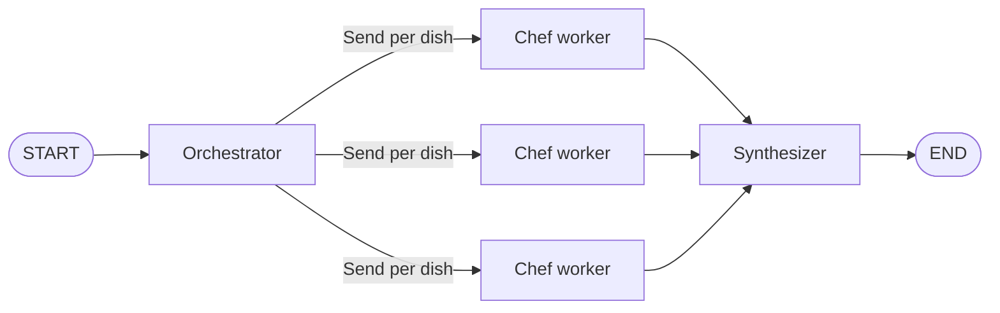
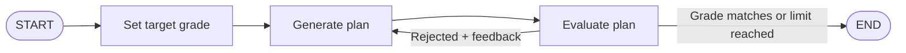

# 🧠 Agentic Workflow Patterns with LangGraph

> Five production-style agent architectures, built as stateful graphs: **chaining, routing, parallelization, orchestrator-worker, and reflection.**


**Quick links:** [Overview](#-overview) · [Patterns](#-patterns-implemented) · [Architecture](#-architecture) · [Quick start](#-quick-start) · [Skills](#-skills-demonstrated)

---

## 📌 Overview

A single LLM call rarely solves a complex task. Real AI systems break work into steps, route requests to specialists, run tasks in parallel, and critique their own output.

This repository implements those patterns end to end. Every workflow shares one idea: a typed **state** object flows through **nodes** (agents), and **edges** decide what happens next.

| Notebook | Patterns covered |
|---|---|
| [`Implement_Workflow_Patterns_with_LangGraph.ipynb`](./Implement_Workflow_Patterns_with_LangGraph.ipynb) | Prompt chaining, routing, parallelization, multi-agent routing exercise |
| [`Build_LangGraph_Design_Patterns_Orchestration_Evaluation.ipynb`](./Build_LangGraph_Design_Patterns_Orchestration_Evaluation.ipynb) | Orchestrator-worker, reflection (generator-evaluator loop) |

---

## 🧩 Patterns Implemented

| # | Pattern | What it does | Demo | Example input |
|---|---|---|---|---|
| 1 | **Prompt Chaining** | Output of one LLM step feeds the next | Job application assistant | A data scientist job description → tailored resume summary → cover letter |
| 2 | **Routing** | An LLM classifies intent and picks a branch | Task router, then a 4-way service router | *"I need a ride from downtown to the airport at 3pm"* → `ride_hailing_call` |
| 3 | **Parallelization** | Independent tasks run at once, then merge | Multilingual translator | One English sentence → French, Spanish, Japanese |
| 4 | **Orchestrator-Worker** | A planner decomposes work and spawns workers dynamically | Meal planner | *"Steak and eggs, tacos, and chili"* → one chef worker per dish |
| 5 | **Reflection** | Generate, critique, refine until a quality target is met | Investment plan advisor | Investor profile → plan refined until risk grade matches target |

---

## 🏗 Architecture

### Orchestrator-Worker
The planner returns a structured `Dishes` object, and `Send()` creates one worker per dish at runtime. Results merge through `Annotated[List[str], operator.add]`.



### Reflection Loop
A bold generator and a conservative evaluator work against each other. A router accepts the plan when the evaluator's grade equals the target grade, or stops after the iteration limit.



### Multi-Agent Router
An LLM bound to a Pydantic `Router` tool picks one of `ride_hailing_call`, `restaurant_order`, `groceries`, or `default_handler`. If the model returns no tool call, the request falls back to the default handler instead of crashing.

---

## 🚀 Quick Start

**Requirements:** Python 3.12+, an OpenAI API key, and [Graphviz](https://graphviz.org/download/) (needed by `pygraphviz` to render graphs).

```bash
git clone https://github.com/<your-username>/<your-repo>.git
cd <your-repo>

pip install langchain-openai==0.3.27 langgraph==0.6.6 pygraphviz==1.14 jupyter

export OPENAI_API_KEY="your-key-here"
jupyter notebook
```

Minimal usage of the compiled routing app:

```python
result = app.invoke({"user_input": "I need milk, bread, eggs, and vegetables for the week"})
print(result["task_type"])   # groceries
print(result["output"])      # organised delivery order
```

---

## 💡 Key Design Decisions

- **Typed state first.** `TypedDict` schemas keep every node small, testable, and predictable.
- **Reducers for safe parallelism.** `operator.add` lets many workers write to the same field without overwriting each other.
- **Structured output for reliability.** Pydantic models turn LLM text into data that downstream nodes can trust.
- **Bounded loops.** The reflection workflow has an iteration cap, so a mismatch can never cause an infinite loop.
- **Graceful fallbacks.** Unrecognised requests are handled, not dropped.

---

## 🎯 Skills Demonstrated

`LangGraph` · `LangChain` · `Multi-agent design` · `Agentic workflows` · `Prompt engineering` · `Structured output (Pydantic)` · `Tool calling` · `Conditional routing` · `Parallel execution` · `State management` · `Workflow visualization`

---

## ⚠️ Notes

- SSL verification is disabled in the notebooks (`verify=False`) to work in the lab sandbox. Remove it in a normal environment.
- The investor personas in the reflection demo are prompt framing only. Output is not financial advice.

---

## 🔭 Next Steps

- [ ] Add retries, fallback nodes, and error handling
- [ ] Track latency, cost, and success rate per node
- [ ] Combine routing with orchestrator-worker for nested multi-agent flows
- [ ] Add a lightweight UI (Gradio or Streamlit) on top of the router

---

## 🙏 Acknowledgements

Based on the IBM Skills Network labs *Implement Workflow Patterns with LangGraph* and *Build LangGraph Design Patterns: Orchestration & Evaluation*, loosely following the official [LangGraph workflows tutorial](https://langchain-ai.github.io/langgraph/tutorials/workflows/).
